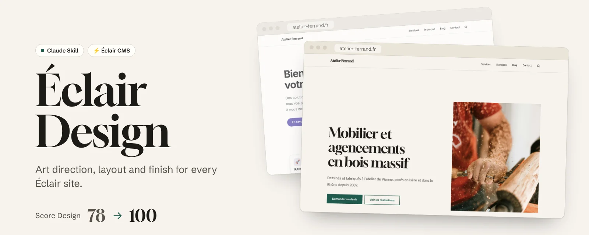
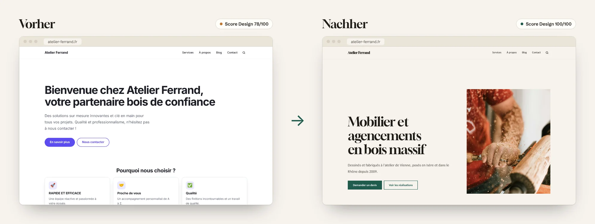
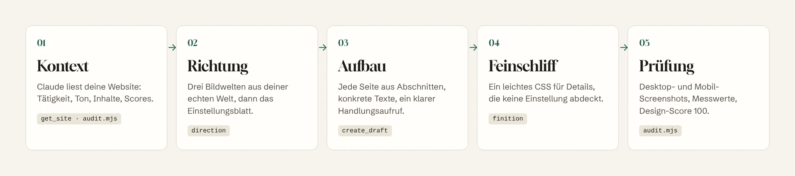
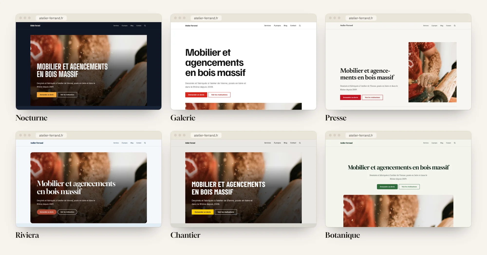
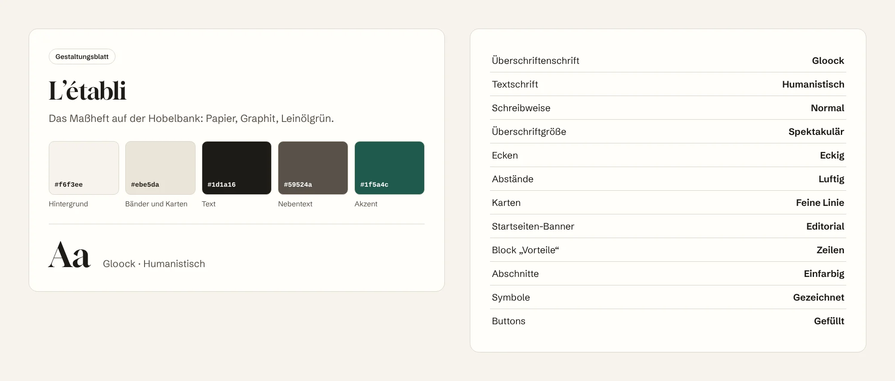
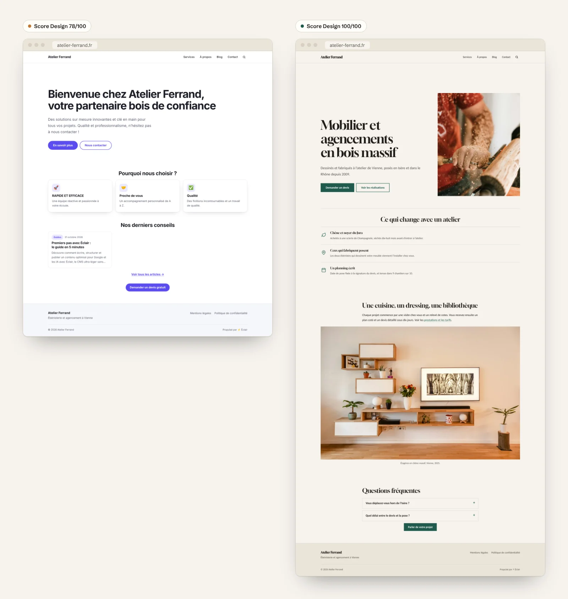
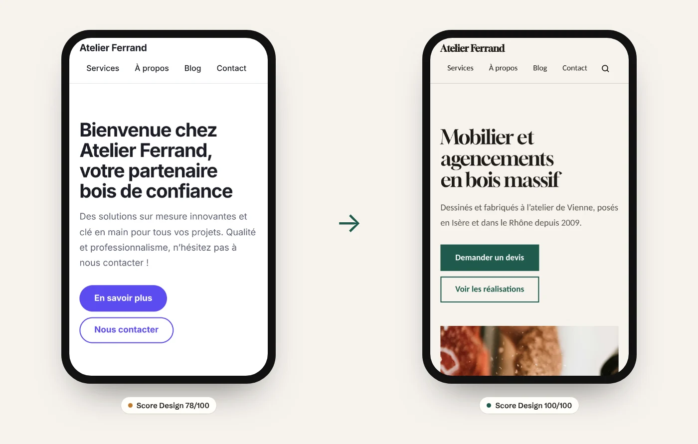

<p align="center">
  <a href="README.md">Français</a> · <a href="README.en.md">English</a> · <a href="README.es.md">Español</a> · <b>Deutsch</b> · <a href="README.pt-BR.md">Português</a> · <a href="README.it.md">Italiano</a>
</p>

<p align="center">
  <picture>
    <source media="(prefers-color-scheme: dark)" srcset="docs/images/banner-dark.webp">
    
  </picture>
</p>

<p align="center">
  
  
  
  
  <a href="LICENSE"></a>
</p>

<h3 align="center">Deine Éclair-Website ist schon so schnell wie eine statische Seite.<br>Éclair Design lässt sie aussehen wie aus einem Designstudio.</h3>

<p align="center">
  <a href="#installation-in-1-minute"><b>Installieren</b></a> ·
  <a href="#warum-éclair-design"><b>Warum</b></a> ·
  <a href="#der-ansatz"><b>Ansatz</b></a> ·
  <a href="#eine-gestaltungsrichtung-kein-theme"><b>Gestaltung</b></a> ·
  <a href="#seiten-die-zum-handeln-bewegen"><b>Seiten</b></a> ·
  <a href="#verwendung"><b>Verwendung</b></a> ·
  <a href="#häufige-fragen"><b>FAQ</b></a>
</p>

<br>

<p align="center">
  
</p>

<p align="center"><sub>Dieselbe Éclair-Website, derselbe Ausgangsinhalt, ein Gespräch mit Claude. Design-Score berechnet von Éclair: 78 → 100.</sub></p>

## Warum Éclair Design

[Éclair CMS](https://github.com/Jacckisback/eclair-cms) erledigt die Technik: Lighthouse 100, SEO und GEO eingebaut, Sicherheit, keine Wartung. Doch eine schnelle Website ist nicht automatisch eine, der man vertraut. Ohne Designerblick sehen viele Websites gleich aus: Standardfarbe, „Willkommen bei…“, drei Karten mit Rakete, „maßgeschneiderte Lösungen“.

**Éclair Design ist ein Skill für Claude**, der die Rolle des Art Directors übernimmt, den die meisten Selbstständigen und kleinen Betriebe nicht haben. Er kennt Éclair von innen: jede Einstellung, jeden Block, jede Regel des Design-Scores. Er liefert kein Mock-up, das erst programmiert werden muss, sondern sagt dir genau, was du einstellst, schreibst und einfügst. Mit dem MCP-Connector von Éclair legt er die Seiten sogar selbst als Entwurf an.

<table>
  <tr>
    <td width="33%" valign="top">
      <h3>🎨 Eine Welt, kein Theme</h3>
      Eine Gestaltungsrichtung aus der echten Welt des Betriebs (die Hobelbank, das Gewächshaus, die Druckerei bei Nacht), mit eigenen Farben, eigener Schrift und eigenen Layouts. Nie die Klischees der Branche, nie die Ticks von KI-generiertem Design.
    </td>
    <td width="33%" valign="top">
      <h3>✍️ Seiten, die zum Handeln bewegen</h3>
      Ein Banner, das sagt wer, was und wo. Vorteile, die belegen statt behaupten. Ein einziger Handlungsweg. Texte ohne leere Floskeln. <b>Ziel: Design-Score 100.</b>
    </td>
    <td width="33%" valign="top">
      <h3>⚡ Nichts geht kaputt</h3>
      Der Skill nutzt nur die Einstellungen von Éclair. Das HTML bleibt gleich: Geschwindigkeit, Barrierefreiheit, SEO und strukturierte Daten bleiben unberührt. Éclair-Updates machen nichts rückgängig.
    </td>
  </tr>
</table>

### Was es dir bringt

| Du bist… | Ohne Éclair Design | Mit Éclair Design |
|---|---|---|
| **Handwerk, Selbstständige, lokales Geschäft** | Eine ordentliche Website, die aussieht wie die der Konkurrenz, oder ein Agenturangebot über deinem Budget | Eine Website, die maßgefertigt wirkt, an einem Nachmittag, mit deinen Worten und deinen Fotos |
| **Freelancer oder Webagentur** | Stunden für Farben, Schriften und Layouts bei jedem Kunden | Eine wiederholbare Methode: bewertetes Audit, 3 Vorschläge für den Kunden, Einstellungsblatt, Seiten als Entwurf |
| **Éclair-Trainer oder -Wiederverkäufer** | „Die Seite ist schnell, aber sieht etwas schlicht aus“ | Ein sofortiges visuelles Argument: dieselbe Website, vorher und nachher |

## Der Ansatz

<p align="center">
  
</p>

Éclair Design verbindet zwei Schulen und passt sie an die Regeln von Éclair an:

- **[Impeccable](https://github.com/pbakaus/impeccable)** (Paul Bakaus) für die Richtung: von **einer konkreten Referenz** aus der Welt des Kunden ausgehen, klare Entscheidungen treffen, Standarddesign ablehnen. Éclair nutzt diese Methode bereits für seine Gestaltungsrichtungen und den Design-Score; der Skill führt sie konsequent zu Ende.
- **[Emil Kowalski](https://github.com/emilkowalski/skill)** für den Feinschliff: die unsichtbaren Details, die sich summieren (Druckgefühl der Buttons, Animationskurven, Hover nur für Maus, ausgerichtete Ziffern), und Animation nur, wenn sie einen Grund hat.

Dazu eine eigene Regel: **mit den Hebeln von Éclair arbeiten, nie dagegen.**

| Reihenfolge | Hebel | Wo |
|---|---|---|
| 1 | Gestaltungsrichtung: 5 Farben, Überschriftenschrift, Layouts | Einstellungen › Darstellung |
| 2 | Seitenaufbau in Abschnitten | Editor oder MCP-Connector |
| 3 | Texte: Titel, Einleitungen, Vorteile, Buttons, FAQ | Editor oder MCP-Connector |
| 4 | Medien: Bannerfoto, Team, Alternativtexte | Mediathek |
| 5 | Eigenes CSS, als letztes Mittel | Einstellungen › Darstellung |

Der Skill verändert nie die Dateien von Éclair (sie werden bei jedem Update überschrieben), erfindet keine Fakten (Preise, Zahlen, Bewertungen) und veröffentlicht nichts: Alles kommt als Entwurf oder als Vorschlag, den du mit einem Klick übernimmst.

## Eine Gestaltungsrichtung, kein Theme

<p align="center">
  
</p>

Éclair bringt 12 Gestaltungsrichtungen mit, jede frei anpassbar. Der Skill hilft dir, **die richtige zu wählen oder deine eigene zu entwickeln**:

1. Er liest dein Geschäft und stellt sich die Welt darum herum vor (Orte, Materialien, Werkzeuge, Licht).
2. Er schlägt **3 wirklich unterschiedliche Richtungen** vor, jede aus einer konkreten Referenz.
3. Er meidet das Klischee deiner Branche (Marineblau und Gold für Kanzleien, Violett für Tech, Beige und Salbei für Wellness) und die Ticks von KI-Design.
4. Er wählt direkt Farben, die die von Éclair garantierten WCAG-Kontraste erfüllen, damit das Ergebnis dem Versprochenen entspricht.
5. Er gibt dir **das Einstellungsblatt**, in genau der Reihenfolge des Bildschirms:

<p align="center">
  
</p>

Du überträgst es in **Einstellungen › Darstellung › Richtung anpassen**, prüfst die Live-Vorschau auf Desktop und Handy und speicherst. Lieber anders? „Ruhiger“, „mutiger“, „hochwertiger“: Der Skill wandelt die Richtung um und gibt dir das vollständige Blatt erneut.

## Seiten, die zum Handeln bewegen

<p align="center">
  
</p>

Eine schöne Palette reicht nicht: Überzeugen tun Aufbau und Worte. Für jede Seitenart (Startseite, Leistung, Über uns, Kontakt, Landingpage, Shop, Artikel) wendet der Skill präzise Rezepte an:

- **Banner**: höchstens 8 Wörter, die sagen, was der Besucher bekommt; eine Einleitung mit Beleg; ein Button aus Verb + Objekt („Angebot anfordern“, nie „Mehr erfahren“).
- **Vorteile**: 3 bis 6, jeder eine überprüfbare Tatsache („Jura-Eiche, 18 Monate getrocknet“) statt eines Adjektivs („Qualität“).
- **Rhythmus**: ein Abschnitt, eine Aufgabe; nie mehr als drei Absätze am Stück; ein einziger Handlungsweg.
- **Texte**: keine leeren Floskeln („innovativ“, „nahtlos“, „erstklassig“), keine schreienden Großbuchstaben, keine erfundenen Fakten. Was fehlt, wird zu `[Zu ergänzen: …]`.

Mit dem MCP-Connector von Éclair legt Claude die Seite **als Entwurf** an und meldet ihre Scores. In der Demo oben: **Design-Score 78 → 100**, und der SEO-Score steigt von 36 auf 69, ohne eine SEO-Einstellung anzufassen, einfach weil die Texte endlich etwas aussagen.

### Auch auf dem Handy

<p align="center">
  
</p>

Jedes Ergebnis wird bei 390 px Breite geprüft. Das Audit-Skript liefert Desktop- und Handy-Screenshots und meldet Überläufe, kleine Tippflächen und umbrochene Titel.

## Installation in 1 Minute

**Mit der `skills`-CLI** (Claude Code, Cursor, Codex und andere kompatible Agenten):

```bash
npx skills add Jacckisback/eclair-design
```

**Von Hand**: Kopiere den Ordner [`skills/eclair-design/`](skills/eclair-design/) nach `~/.claude/skills/` (alle Projekte) oder in `.claude/skills/` eines Projekts.

**Auf Claude.ai**: Ordner `eclair-design` als ZIP packen und im Bereich Skills der Einstellungen hochladen.

**Damit Claude direkt an deiner Website arbeitet** (empfohlen): In Éclair **Einstellungen › KI-Assistent** öffnen, **MCP-Verbindungen erlauben** aktivieren und die Adresse `https://deine-website.de/_eclair/mcp` in Claude als benutzerdefinierten Connector hinzufügen. Ohne Connector arbeitet der Skill mit der URL der Website und gibt dir Texte und Einstellungen zum Übertragen.

**Für das automatische Audit**: Node 18+ und Playwright (`npm i -D playwright && npx playwright install chromium`).

## Verwendung

| Befehl | Was du bekommst |
|---|---|
| `/eclair-design audit https://deine-website.de` | Note von 32 Punkten in 8 Kriterien, Desktop- und Handy-Screenshots, Aktionsplan P0 → P3 |
| `/eclair-design direction` | 3 Vorschläge aus deinem Geschäft, dann das Einstellungsblatt des gewählten |
| `/eclair-design page accueil` | Die Startseite Abschnitt für Abschnitt, mit Texten, als Entwurf angelegt |
| `/eclair-design finition` | Ein kommentierter CSS-Block, sicher für Lighthouse 100 |
| `/eclair-design plus-sobre` · `plus-audacieux` · `épurer` | Die Richtung ruhiger, mutiger oder reduzierter, mit vollständigem Blatt |

Oder sprich einfach:

> „Lass meine Éclair-Website professioneller aussehen. Ich bin Schreiner in Freiburg und baue vor allem Küchen und Bücherregale nach Maß.“

> „Mach die Startseite meiner Installateur-Website neu: mehr Anrufe, weniger Gerede.“

> „Mach ein Design-Audit von https://meine-website.de und sag mir, womit ich anfangen soll.“

Der Skill antwortet in deiner Sprache; seine Befehle behalten ihre französischen Namen, denn Éclair stammt aus Frankreich.

### Beispiel für den Feinschliff

CSS kommt zuletzt, wenn Richtung und Seiten stehen. Es nutzt nur die Variablen des Themes und folgt so der Richtung und dem Dunkelmodus:

```css
/* Buttons: benannte Eigenschaften, knackige Kurve */
:root{--ease-out:cubic-bezier(.23,1,.32,1)}
.btn{transition:transform .16s var(--ease-out),box-shadow .2s var(--ease-out),background-color .2s ease}
@media (prefers-reduced-motion:no-preference){.btn:active{transform:scale(.97)}}

/* Hover: nur mit Maus (auf dem Handy bleibt er hängen) */
@media not all and (hover:hover) and (pointer:fine){.btn:hover,.card:hover{transform:none;box-shadow:none}}

/* Titel: kein Wort per Bindestrich getrennt auf dem Handy */
h1,h2,.hero-title{hyphens:manual}
```

## Was der Skill enthält

```
skills/eclair-design/
├── SKILL.md                  Methode, Hebel, Befehle, Schutzregeln
├── reference/
│   ├── leviers.md            erlaubte Werte von Éclair, Abschnitte, MCP, Design-Score, Symbole, CSS
│   ├── direction.md          Richtung entwickeln und umwandeln, Einstellungsblatt
│   ├── composition.md        Seitenrezepte und Schreibregeln
│   ├── finition-css.md       eigenes CSS für den Feinschliff
│   └── audit.md              Bewertungsraster mit 32 Punkten und Berichtsvorlage
├── scripts/audit.mjs         Desktop- und Handy-Screenshots, Messwerte
└── NOTICE.md                 Danksagungen
```

Alle Werte (Farben, 18 Schriften, Layouts, Regeln des Design-Scores, 65 Symbole) stammen aus dem Code von Éclair 1.14.1 und sind nicht erfunden. Die internen Anweisungen des Skills sind auf Französisch.

## Häufige Fragen

**Muss ich programmieren können?**
Nein. Der Skill gibt dir Einstellungen zum Übertragen und Texte zum Einfügen. CSS ist optional und kommt einfügefertig.

**Wird meine Website langsamer?**
Nein. Die Gestaltungsrichtung ist eine native Einstellung von Éclair (eine einzige Überschriftenschrift, von deiner eigenen Website ausgeliefert). Das Feinschliff-CSS wiegt etwa 1 KB. Das HTML ändert sich nicht.

**Kann Claude etwas kaputt machen oder veröffentlichen?**
Nein. Der MCP-Connector von Éclair legt nur Entwürfe und Vorschläge an; er veröffentlicht, löscht und ändert keine Einstellungen. Die Klicks machst du.

**Was kostet das?**
Der Skill ist kostenlos und Open Source. Er läuft mit deinem Claude-Abo; der MCP-Connector von Éclair nutzt keinen API-Schlüssel deiner Website.

**Und ohne MCP-Connector?**
Der Skill liest deine Website über ihre URL und gibt dir alles zum Einfügen. Der Connector spart nur Zeit.

**Funktioniert das mit WordPress oder einem anderen CMS?**
Nein, und das ist Absicht: Der Skill ist präzise, weil er jede Einstellung von Éclair kennt. Die Methode gilt auch anderswo, die Blätter nicht.

## Danksagungen und Lizenz

- Methoden angepasst aus [Impeccable](https://github.com/pbakaus/impeccable) (Paul Bakaus, Apache 2.0) und den [Skills von Emil Kowalski](https://github.com/emilkowalski/skill) (MIT). Details in [NOTICE.md](skills/eclair-design/NOTICE.md).
- Demo: „Atelier Ferrand“ ist ein fiktiver Betrieb. Fotos von [Unsplash](https://unsplash.com/license). Screenshots mit Éclair 1.14.1; die Scores sind die von Éclair berechneten.
- Schriften von Fontsource (SIL Open Font License), Éclair-Symbole abgeleitet von Lucide (ISC).

© 2026 Thierry Gustin · [Éclair CMS](https://github.com/Jacckisback/eclair-cms) · Lizenz [AGPL-3.0](LICENSE).
