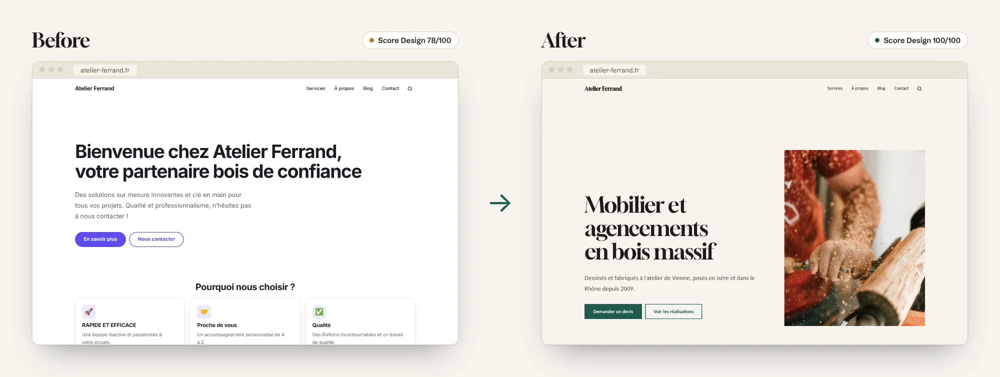
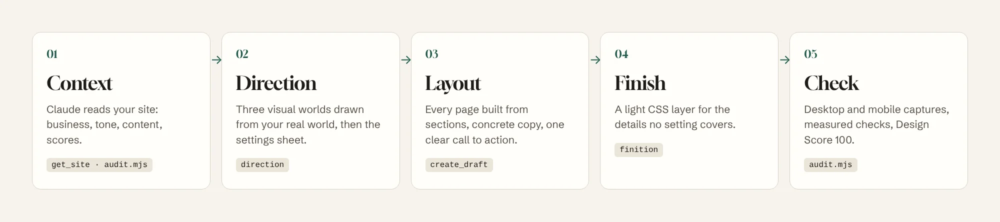
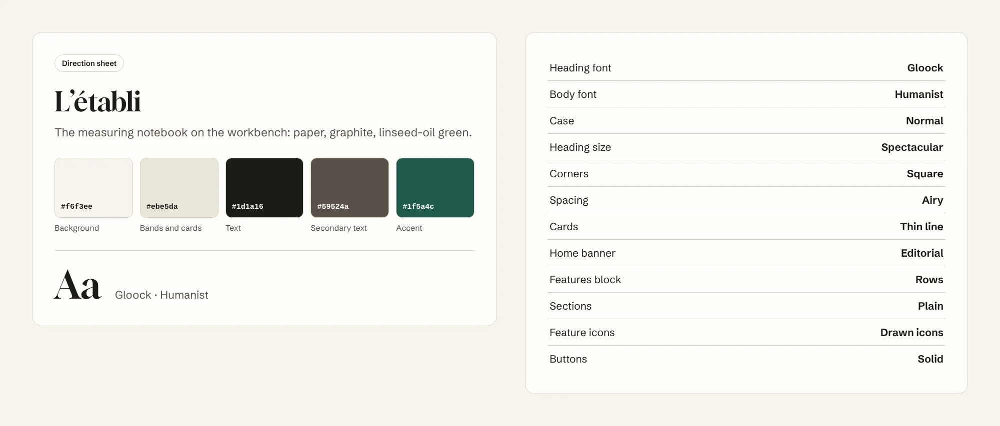

<p align="center">
  <a href="README.md">Français</a> · <b>English</b> · <a href="README.es.md">Español</a> · <a href="README.de.md">Deutsch</a> · <a href="README.pt-BR.md">Português</a> · <a href="README.it.md">Italiano</a>
</p>

<p align="center">
  <picture>
    <source media="(prefers-color-scheme: dark)" srcset="docs/images/banner-dark.webp">
    
  </picture>
</p>

<p align="center">
  
  
  
  
  <a href="LICENSE"></a>
</p>

<h3 align="center">Your Éclair site already has the speed of a static site.<br>Éclair Design gives it the look of a studio-made one.</h3>

<p align="center">
  <a href="#install-in-1-minute"><b>Install</b></a> ·
  <a href="#why-éclair-design"><b>Why</b></a> ·
  <a href="#the-approach"><b>Approach</b></a> ·
  <a href="#an-art-direction-not-a-theme"><b>Art direction</b></a> ·
  <a href="#pages-that-make-people-act"><b>Pages</b></a> ·
  <a href="#usage"><b>Usage</b></a> ·
  <a href="#faq"><b>FAQ</b></a>
</p>

<br>

<p align="center">
  
</p>

<p align="center"><sub>Same Éclair site, same starting content, one conversation with Claude. Design Score computed by Éclair: 78 → 100.</sub></p>

## Why Éclair Design

[Éclair CMS](https://github.com/Jacckisback/eclair-cms) takes care of the technical side: Lighthouse 100, built-in SEO and GEO, security, zero maintenance. But a fast site is not necessarily a site people trust. Without a designer's eye, many sites end up alike: default colour, "Welcome to…", three cards with a rocket, "tailored solutions".

**Éclair Design is a Claude skill** that plays the art director most freelancers and small businesses don't have. It knows Éclair from the inside: every setting, every block, every Design Score rule. It doesn't hand you a mock-up to rebuild: it tells you exactly what to set, what to write and what to paste, and with Éclair's MCP connector it drafts the pages itself.

<table>
  <tr>
    <td width="33%" valign="top">
      <h3>🎨 A world, not a theme</h3>
      An art direction drawn from the business's real world (the workbench, the greenhouse, the night print shop), with its own colours, typeface and layouts. Never the category clichés, never the tics of AI-generated design.
    </td>
    <td width="33%" valign="top">
      <h3>✍️ Pages that make people act</h3>
      A banner that says who, what and where. Features that prove instead of claim. One path to action. Copy without empty buzzwords. <b>Target Design Score: 100.</b>
    </td>
    <td width="33%" valign="top">
      <h3>⚡ Nothing breaks</h3>
      The skill only uses Éclair's own settings. The HTML stays the same: speed, accessibility, SEO and structured data are untouched. Éclair updates undo nothing.
    </td>
  </tr>
</table>

### What it brings you

| You are… | Without Éclair Design | With Éclair Design |
|---|---|---|
| **Craftsperson, freelancer, local shop** | A decent site that looks like your competitors', or an agency quote beyond your budget | A site that looks custom-made, in an afternoon, with your words and your photos |
| **Freelance web designer or agency** | Hours choosing colours, fonts and layouts for each client | A repeatable method: scored audit, 3 options to show the client, settings sheet, draft pages |
| **Éclair trainer or reseller** | "The site is fast, but it looks a bit basic" | An instant visual argument: the same site, before and after |

## The approach

<p align="center">
  
</p>

Éclair Design brings two schools together and bends them to Éclair's constraints:

- **[Impeccable](https://github.com/pbakaus/impeccable)** (Paul Bakaus) for direction: start from **one concrete reference** in the client's world, make bold choices, refuse default design. Éclair already draws on it for its art directions and Design Score; the skill takes the method all the way.
- **[Emil Kowalski](https://github.com/emilkowalski/skill)** for the finish: the invisible details that add up (button press, animation curves, hover only for mouse users, aligned figures), and animation only when it has a reason.

Plus one rule of its own: **work with Éclair's levers, never against them.**

| Order | Lever | Where |
|---|---|---|
| 1 | Art direction: 5 colours, heading typeface, layouts | Settings › Appearance |
| 2 | Page layout in sections | Editor, or MCP connector |
| 3 | Copy: titles, lead lines, features, buttons, FAQ | Editor, or MCP connector |
| 4 | Media: banner photo, team, alt text | Media library |
| 5 | Custom CSS, as a last resort | Settings › Appearance |

The skill never touches Éclair's files (overwritten by every update), never invents facts (prices, figures, reviews) and never publishes: everything arrives as a draft or a proposal you approve in one click.

## An art direction, not a theme

<p align="center">
  
</p>

Éclair ships 12 art directions, each fully adjustable. The skill helps you **pick the right one, or create your own**:

1. it reads your business and pictures the physical world around it (places, materials, tools, light);
2. it suggests **3 genuinely different options**, each drawn from a concrete reference;
3. it avoids your category's cliché (navy and gold for lawyers, purple for tech, beige and sage for wellness) and the tics of AI design;
4. it aims straight for colours that pass the WCAG contrast Éclair guarantees, so the result is the one announced;
5. it hands you **the settings sheet**, in the exact order of the screen:

<p align="center">
  
</p>

Copy it into **Settings › Appearance › Adjust the direction**, check the live preview on desktop and mobile, save. Want a change? "Quieter", "bolder", "more upscale": the skill transforms the direction and gives you the full sheet again.

## Pages that make people act

<p align="center">
  
</p>

A nice palette is not enough: layout and words are what convince. For every kind of page (home, service, about, contact, landing, shop, article), the skill applies precise recipes:

- **Banner**: 8 words at most, saying what the visitor gets; a lead line that brings proof; a verb + object button ("Request a quote", never "Learn more").
- **Features**: 3 to 6, each a verifiable fact ("Jura oak dried for 18 months") rather than an adjective ("Quality").
- **Rhythm**: one section, one role; never more than three paragraphs in a row; one path to action.
- **Copy**: no empty buzzwords ("innovative", "turnkey", "seamless"), no shouting capitals, no invented facts. What's missing becomes `[To complete: …]`.

With Éclair's MCP connector, Claude creates the page **as a draft** and reports its scores. On the demo above: **Design Score 78 → 100**, and the SEO score goes from 36 to 69 without touching any SEO setting, simply because the copy finally says something.

### On mobile too

<p align="center">
  
</p>

Every deliverable is checked at 390 px wide. The audit script provides desktop and mobile captures and flags overflow, small tap targets and broken titles.

## Install in 1 minute

**With the `skills` CLI** (Claude Code, Cursor, Codex and other compatible agents):

```bash
npx skills add Jacckisback/eclair-design
```

**By hand**: copy the [`skills/eclair-design/`](skills/eclair-design/) folder into `~/.claude/skills/` (all your projects) or into a project's `.claude/skills/`.

**On Claude.ai**: zip the `eclair-design` folder and upload it in the Skills section of the settings.

**So Claude can work directly on your site** (recommended): in Éclair, open **Settings › AI assistant**, turn on **Allow MCP connections**, then add `https://your-site.com/_eclair/mcp` as a custom connector in Claude. Without the connector, the skill works from the site's URL and gives you the copy and settings to paste.

**For the automatic audit**: Node 18+ and Playwright (`npm i -D playwright && npx playwright install chromium`).

## Usage

| Command | What you get |
|---|---|
| `/eclair-design audit https://your-site.com` | Score out of 32 on 8 criteria, desktop and mobile captures, P0 → P3 action plan |
| `/eclair-design direction` | 3 options drawn from your business, then the settings sheet for the one you pick |
| `/eclair-design page accueil` | The home page built section by section, copy included, created as a draft |
| `/eclair-design finition` | A commented custom CSS block, safe for Lighthouse 100 |
| `/eclair-design plus-sobre` · `plus-audacieux` · `épurer` | The direction made quieter, bolder or cleaner, with the full sheet |

Or just talk:

> "Make my Éclair site look more professional. I'm a cabinetmaker near Lyon, mostly custom kitchens and bookcases."

> "Redo my plumber site's home page: I want more calls, less fluff."

> "Run a design audit of https://my-site.com and tell me where to start."

The skill answers in your language; its built-in commands keep their French names, since Éclair was born in France.

### Finishing example

CSS comes last, once the direction and pages are in place. It only uses the theme's variables, so it follows the direction and dark mode:

```css
/* Buttons: named properties, crisp curve */
:root{--ease-out:cubic-bezier(.23,1,.32,1)}
.btn{transition:transform .16s var(--ease-out),box-shadow .2s var(--ease-out),background-color .2s ease}
@media (prefers-reduced-motion:no-preference){.btn:active{transform:scale(.97)}}

/* Hover: mouse only (on phones it sticks) */
@media not all and (hover:hover) and (pointer:fine){.btn:hover,.card:hover{transform:none;box-shadow:none}}

/* Titles: no word broken by a hyphen on mobile */
h1,h2,.hero-title{hyphens:manual}
```

## What's inside

```
skills/eclair-design/
├── SKILL.md                  method, levers, commands, safeguards
├── reference/
│   ├── leviers.md            Éclair's allowed values, sections, MCP, Design Score, icons, CSS
│   ├── direction.md          creating and transforming a direction, settings sheet
│   ├── composition.md        page recipes and writing rules
│   ├── finition-css.md       finishing custom CSS
│   └── audit.md              32-point scoring grid and report template
├── scripts/audit.mjs         desktop + mobile captures and measured checks
└── NOTICE.md                 credits
```

Every value (colours, 18 typefaces, layouts, Design Score rules, 65 icons) was read from Éclair 1.14.1's source code, not made up. The skill's own instructions are written in French.

## FAQ

**Do I need to code?**
No. The skill gives you settings to copy and copy to paste. CSS is optional and ready to paste.

**Will my site get slower?**
No. The art direction is a native Éclair setting (a single heading typeface, served by your own site). The finishing CSS weighs about 1 KB. The HTML doesn't change.

**Can Claude break or publish something?**
No. Éclair's MCP connector only creates drafts and proposals; it never publishes, deletes or changes settings. You do the clicking.

**How much does it cost?**
The skill is free and open source. It runs on your Claude subscription; Éclair's MCP connector uses no API key from your site.

**And without the MCP connector?**
The skill reads your site from its URL and gives you everything to paste. The connector just saves time.

**Does it work with WordPress or another CMS?**
No, on purpose: the skill is precise because it knows every Éclair setting. The method still applies elsewhere, but the sheets don't.

## Credits and license

- Methods adapted from [Impeccable](https://github.com/pbakaus/impeccable) (Paul Bakaus, Apache 2.0) and [Emil Kowalski's skills](https://github.com/emilkowalski/skill) (MIT). Details in [NOTICE.md](skills/eclair-design/NOTICE.md).
- Demo: “Atelier Ferrand” is a fictitious business. Photos from [Unsplash](https://unsplash.com/license). Captures made with Éclair 1.14.1; scores are the ones Éclair computes.
- Fontsource typefaces (SIL Open Font License), Éclair icons derived from Lucide (ISC).

© 2026 Thierry Gustin · [Éclair CMS](https://github.com/Jacckisback/eclair-cms) · [AGPL-3.0](LICENSE) license.
