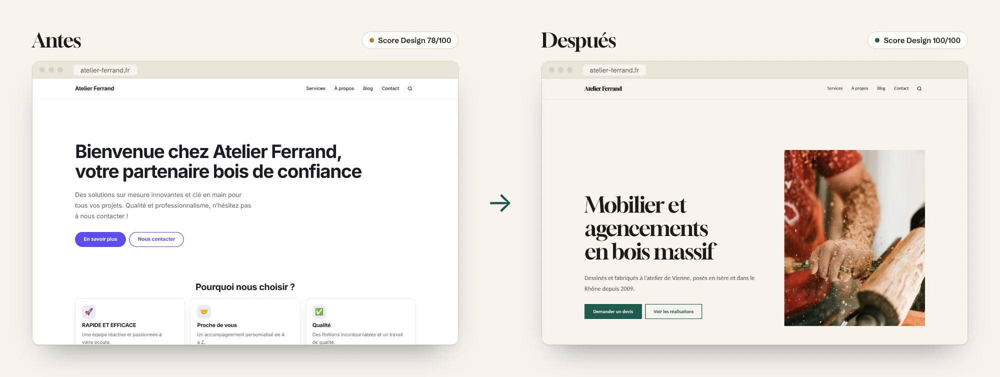
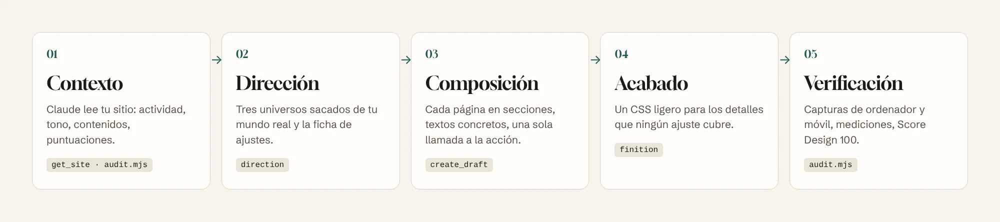
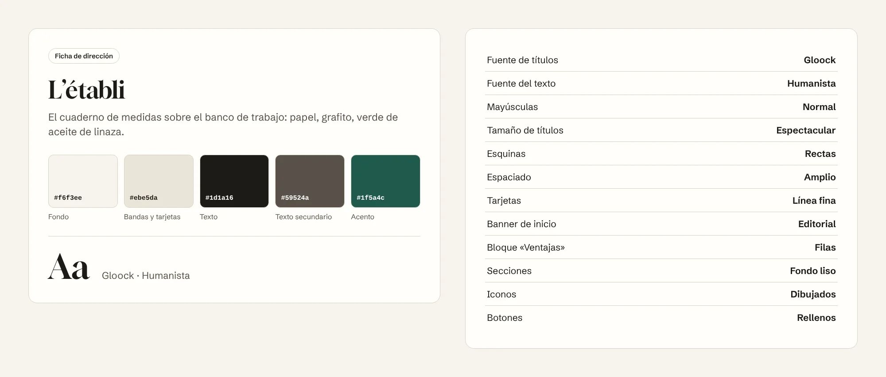

<p align="center">
  <a href="README.md">Français</a> · <a href="README.en.md">English</a> · <b>Español</b> · <a href="README.de.md">Deutsch</a> · <a href="README.pt-BR.md">Português</a> · <a href="README.it.md">Italiano</a>
</p>

<p align="center">
  <picture>
    <source media="(prefers-color-scheme: dark)" srcset="docs/images/banner-dark.webp">
    
  </picture>
</p>

<p align="center">
  
  
  
  
  <a href="LICENSE"></a>
</p>

<h3 align="center">Tu web Éclair ya tiene la velocidad de un sitio estático.<br>Éclair Design le da el aspecto de una web hecha por un estudio.</h3>

<p align="center">
  <a href="#instalar-en-1-minuto"><b>Instalar</b></a> ·
  <a href="#por-qué-éclair-design"><b>Por qué</b></a> ·
  <a href="#el-enfoque"><b>Enfoque</b></a> ·
  <a href="#una-dirección-artística-no-un-tema"><b>Dirección artística</b></a> ·
  <a href="#páginas-que-hacen-actuar"><b>Páginas</b></a> ·
  <a href="#uso"><b>Uso</b></a> ·
  <a href="#preguntas-frecuentes"><b>FAQ</b></a>
</p>

<br>

<p align="center">
  
</p>

<p align="center"><sub>La misma web Éclair, el mismo contenido de partida, una conversación con Claude. Score Design calculado por Éclair: 78 → 100.</sub></p>

## Por qué Éclair Design

[Éclair CMS](https://github.com/Jacckisback/eclair-cms) resuelve la parte técnica: Lighthouse 100, SEO y GEO integrados, seguridad, cero mantenimiento. Pero una web rápida no es necesariamente una web que inspira confianza. Sin ojo de diseñador, muchas webs acaban pareciéndose: color por defecto, «Bienvenido a…», tres tarjetas con un cohete, «soluciones a medida».

**Éclair Design es un skill para Claude** que hace de director artístico, ese que la mayoría de autónomos y pequeñas empresas no tienen. Conoce Éclair por dentro: cada ajuste, cada bloque, cada regla del Score Design. No te entrega una maqueta que haya que programar: te dice exactamente qué ajustar, qué escribir y qué pegar, y con el conector MCP de Éclair prepara él mismo las páginas en borrador.

<table>
  <tr>
    <td width="33%" valign="top">
      <h3>🎨 Un universo, no un tema</h3>
      Una dirección artística sacada del mundo real del negocio (el banco de trabajo, el invernadero, la imprenta de noche), con sus colores, su tipografía y sus composiciones. Nunca los tópicos del sector, nunca los tics del diseño generado por IA.
    </td>
    <td width="33%" valign="top">
      <h3>✍️ Páginas que hacen actuar</h3>
      Un banner que dice quién, qué y dónde. Ventajas que demuestran en lugar de afirmar. Un solo camino de acción. Textos sin fórmulas huecas. <b>Objetivo: Score Design 100.</b>
    </td>
    <td width="33%" valign="top">
      <h3>⚡ Nada se rompe</h3>
      El skill solo usa los ajustes de Éclair. El HTML no cambia: velocidad, accesibilidad, SEO y datos estructurados quedan intactos. Las actualizaciones de Éclair no deshacen nada.
    </td>
  </tr>
</table>

### Lo que te aporta

| Eres… | Sin Éclair Design | Con Éclair Design |
|---|---|---|
| **Artesano, autónomo, comercio** | Una web correcta que se parece a la de la competencia, o un presupuesto de agencia fuera de tu alcance | Una web que parece hecha a medida, en una tarde, con tus palabras y tus fotos |
| **Freelance o agencia web** | Horas eligiendo colores, tipografías y maquetación para cada cliente | Un método repetible: auditoría puntuada, 3 propuestas para el cliente, ficha de ajustes, páginas en borrador |
| **Formador o revendedor de Éclair** | «La web es rápida, pero se ve algo básica» | Un argumento visual inmediato: la misma web, antes y después |

## El enfoque

<p align="center">
  
</p>

Éclair Design une dos escuelas y las adapta a las reglas de Éclair:

- **[Impeccable](https://github.com/pbakaus/impeccable)** (Paul Bakaus) para la dirección: partir de **una referencia concreta** del mundo del cliente, tomar decisiones claras, rechazar el diseño por defecto. Éclair ya se inspira en él para sus direcciones artísticas y su Score Design; el skill lleva el método hasta el final.
- **[Emil Kowalski](https://github.com/emilkowalski/skill)** para el acabado: los detalles invisibles que suman (la pulsación de los botones, las curvas de animación, el hover solo con ratón, las cifras alineadas), y animación solo cuando tiene una razón.

Y una regla propia de Éclair: **trabajar con sus palancas, nunca contra ellas.**

| Orden | Palanca | Dónde |
|---|---|---|
| 1 | Dirección artística: 5 colores, tipografía de títulos, composiciones | Ajustes › Apariencia |
| 2 | Composición de las páginas en secciones | Editor, o conector MCP |
| 3 | Textos: títulos, entradillas, ventajas, botones, FAQ | Editor, o conector MCP |
| 4 | Medios: foto del banner, equipo, textos alternativos | Biblioteca de medios |
| 5 | CSS personalizado, como último recurso | Ajustes › Apariencia |

El skill nunca toca los archivos de Éclair (se sobrescriben en cada actualización), no inventa ningún dato (precios, cifras, opiniones) y no publica nada: todo llega como borrador o como propuesta que validas con un clic.

## Una dirección artística, no un tema

<p align="center">
  
</p>

Éclair incluye 12 direcciones artísticas, todas ajustables. El skill te ayuda a **elegir la adecuada o crear la tuya**:

1. lee tu actividad e imagina el mundo físico que la rodea (lugares, materiales, herramientas, luz);
2. propone **3 opciones realmente distintas**, cada una sacada de una referencia concreta;
3. evita el tópico de tu sector (azul marino y dorado para abogados, morado para tecnología, beige y verde salvia para bienestar) y los tics del diseño por IA;
4. elige directamente colores que superan los contrastes WCAG que Éclair garantiza, para que el resultado sea el anunciado;
5. te entrega **la ficha de ajustes**, en el orden exacto de la pantalla:

<p align="center">
  
</p>

La copias en **Ajustes › Apariencia › Ajustar la dirección**, miras la vista previa en directo en ordenador y móvil, y guardas. ¿Quieres retocarla? «Más sobria», «más atrevida», «más de gama alta»: el skill transforma la dirección y te devuelve la ficha completa.

## Páginas que hacen actuar

<p align="center">
  
</p>

Una paleta bonita no basta: lo que convence es la composición y las palabras. Para cada tipo de página (inicio, servicio, quiénes somos, contacto, landing, tienda, artículo), el skill aplica recetas precisas:

- **Banner**: 8 palabras como máximo, que dicen lo que obtiene el visitante; una entradilla que aporta una prueba; un botón verbo + objeto («Pedir presupuesto», nunca «Saber más»).
- **Ventajas**: de 3 a 6, cada una un hecho comprobable («Roble del Jura secado 18 meses») en lugar de un adjetivo («Calidad»).
- **Ritmo**: una sección, una función; nunca más de tres párrafos seguidos; un solo camino de acción.
- **Textos**: sin fórmulas huecas («innovador», «llave en mano», «de vanguardia»), sin mayúsculas estridentes, sin datos inventados. Lo que falta queda como `[A completar: …]`.

Con el conector MCP de Éclair, Claude crea la página **en borrador** y te devuelve sus puntuaciones. En la demo de arriba: **Score Design 78 → 100**, y la puntuación SEO pasa de 36 a 69 sin tocar ningún ajuste SEO, simplemente porque los textos por fin dicen algo.

### También en el móvil

<p align="center">
  
</p>

Cada entrega se comprueba a 390 px de ancho. El script de auditoría genera capturas de ordenador y móvil, y señala desbordamientos, zonas táctiles pequeñas y títulos cortados.

## Instalar en 1 minuto

**Con la CLI `skills`** (Claude Code, Cursor, Codex y otros agentes compatibles):

```bash
npx skills add Jacckisback/eclair-design
```

**A mano**: copia la carpeta [`skills/eclair-design/`](skills/eclair-design/) en `~/.claude/skills/` (todos tus proyectos) o en `.claude/skills/` de un proyecto.

**En Claude.ai**: comprime la carpeta `eclair-design` en zip e impórtala en la sección Skills de los ajustes.

**Para que Claude trabaje directamente en tu web** (recomendado): en Éclair, abre **Ajustes › Asistente IA**, activa **Permitir conexiones MCP** y añade la dirección `https://tu-web.es/_eclair/mcp` como conector personalizado en Claude. Sin conector, el skill trabaja a partir de la URL de la web y te da los textos y ajustes para copiar.

**Para la auditoría automática**: Node 18+ y Playwright (`npm i -D playwright && npx playwright install chromium`).

## Uso

| Comando | Lo que obtienes |
|---|---|
| `/eclair-design audit https://tu-web.es` | Nota sobre 32 en 8 criterios, capturas de ordenador y móvil, plan de acción P0 → P3 |
| `/eclair-design direction` | 3 propuestas sacadas de tu actividad y la ficha de ajustes de la que elijas |
| `/eclair-design page accueil` | La página de inicio compuesta sección a sección, textos incluidos, creada en borrador |
| `/eclair-design finition` | Un bloque de CSS personalizado comentado, seguro para Lighthouse 100 |
| `/eclair-design plus-sobre` · `plus-audacieux` · `épurer` | La dirección más sobria, más atrevida o más depurada, con la ficha completa |

O simplemente habla:

> «Haz que mi web Éclair parezca más profesional. Soy ebanista en Madrid, hago sobre todo cocinas y librerías a medida.»

> «Rehaz la página de inicio de mi web de fontanero: quiero más llamadas y menos paja.»

> «Haz la auditoría de diseño de https://mi-web.es y dime por dónde empezar.»

El skill te responde en tu idioma; sus comandos conservan el nombre en francés, porque Éclair nació en Francia.

### Ejemplo de acabado

El CSS llega al final, cuando la dirección y las páginas están listas. Solo usa las variables del tema, así que sigue la dirección y el modo oscuro:

```css
/* Botones: propiedades explícitas, curva nítida */
:root{--ease-out:cubic-bezier(.23,1,.32,1)}
.btn{transition:transform .16s var(--ease-out),box-shadow .2s var(--ease-out),background-color .2s ease}
@media (prefers-reduced-motion:no-preference){.btn:active{transform:scale(.97)}}

/* Hover: solo con ratón (en el móvil se queda pegado) */
@media not all and (hover:hover) and (pointer:fine){.btn:hover,.card:hover{transform:none;box-shadow:none}}

/* Títulos: ninguna palabra cortada con guion en el móvil */
h1,h2,.hero-title{hyphens:manual}
```

## Qué contiene el skill

```
skills/eclair-design/
├── SKILL.md                  método, palancas, comandos, salvaguardas
├── reference/
│   ├── leviers.md            valores permitidos de Éclair, secciones, MCP, Score Design, iconos, CSS
│   ├── direction.md          crear y transformar una dirección, ficha de ajustes
│   ├── composition.md        recetas de páginas y reglas de redacción
│   ├── finition-css.md       CSS personalizado de acabado
│   └── audit.md              tabla de puntuación sobre 32 y modelo de informe
├── scripts/audit.mjs         capturas de ordenador + móvil y mediciones
└── NOTICE.md                 créditos
```

Todos los valores (colores, 18 tipografías, composiciones, reglas del Score Design, 65 iconos) se han tomado del código de Éclair 1.14.1, no se han inventado. Las instrucciones internas del skill están en francés.

## Preguntas frecuentes

**¿Hay que saber programar?**
No. El skill te da ajustes para copiar y textos para pegar. El CSS es opcional y llega listo para pegar.

**¿Mi web irá más lenta?**
No. La dirección artística es un ajuste nativo de Éclair (una sola tipografía de títulos, servida por tu propia web). El CSS de acabado pesa alrededor de 1 KB. El HTML no cambia.

**¿Puede Claude romper o publicar algo?**
No. El conector MCP de Éclair solo crea borradores y propuestas; no publica, no borra y no cambia ajustes. Los clics los haces tú.

**¿Cuánto cuesta?**
El skill es gratuito y de código abierto. Funciona con tu suscripción de Claude; el conector MCP de Éclair no usa ninguna clave de API de tu web.

**¿Y sin el conector MCP?**
El skill lee tu web a partir de su URL y te da todo para copiar. El conector solo te ahorra tiempo.

**¿Funciona con WordPress u otro CMS?**
No, y es a propósito: el skill es preciso porque conoce cada ajuste de Éclair. El método sirve en otros sitios, pero las fichas no.

## Créditos y licencia

- Métodos adaptados de [Impeccable](https://github.com/pbakaus/impeccable) (Paul Bakaus, Apache 2.0) y de los [skills de Emil Kowalski](https://github.com/emilkowalski/skill) (MIT). Detalles en [NOTICE.md](skills/eclair-design/NOTICE.md).
- Demo: «Atelier Ferrand» es un negocio ficticio. Fotos de [Unsplash](https://unsplash.com/license). Capturas hechas con Éclair 1.14.1; las puntuaciones son las que calcula Éclair.
- Tipografías de Fontsource (SIL Open Font License), iconos de Éclair derivados de Lucide (ISC).

© 2026 Thierry Gustin · [Éclair CMS](https://github.com/Jacckisback/eclair-cms) · Licencia [AGPL-3.0](LICENSE).
