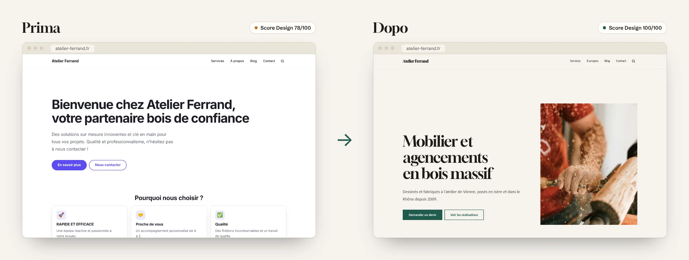
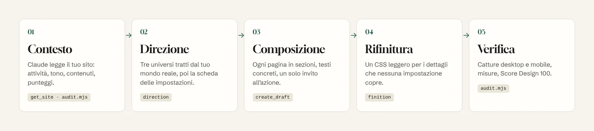
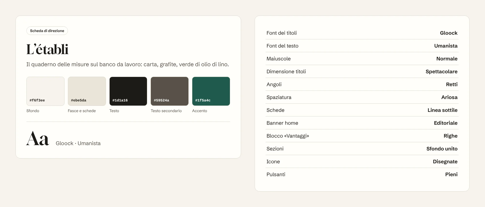

<p align="center">
  <a href="README.md">Français</a> · <a href="README.en.md">English</a> · <a href="README.es.md">Español</a> · <a href="README.de.md">Deutsch</a> · <a href="README.pt-BR.md">Português</a> · <b>Italiano</b>
</p>

<p align="center">
  <picture>
    <source media="(prefers-color-scheme: dark)" srcset="docs/images/banner-dark.webp">
    
  </picture>
</p>

<p align="center">
  
  
  
  
  <a href="LICENSE"></a>
</p>

<h3 align="center">Il tuo sito Éclair ha già la velocità di un sito statico.<br>Éclair Design gli dà l'aspetto di un sito fatto da uno studio.</h3>

<p align="center">
  <a href="#installare-in-1-minuto"><b>Installare</b></a> ·
  <a href="#perché-éclair-design"><b>Perché</b></a> ·
  <a href="#lapproccio"><b>Approccio</b></a> ·
  <a href="#una-direzione-artistica-non-un-tema"><b>Direzione artistica</b></a> ·
  <a href="#pagine-che-fanno-agire"><b>Pagine</b></a> ·
  <a href="#come-si-usa"><b>Come si usa</b></a> ·
  <a href="#domande-frequenti"><b>FAQ</b></a>
</p>

<br>

<p align="center">
  
</p>

<p align="center"><sub>Lo stesso sito Éclair, lo stesso contenuto di partenza, una conversazione con Claude. Score Design calcolato da Éclair: 78 → 100.</sub></p>

## Perché Éclair Design

[Éclair CMS](https://github.com/Jacckisback/eclair-cms) risolve la parte tecnica: Lighthouse 100, SEO e GEO integrati, sicurezza, zero manutenzione. Ma un sito veloce non è per forza un sito che ispira fiducia. Senza l'occhio di un designer, molti siti finiscono per somigliarsi: colore predefinito, «Benvenuti da…», tre schede con un razzo, «soluzioni su misura».

**Éclair Design è uno skill per Claude** che fa da direttore artistico, quello che la maggior parte dei liberi professionisti e delle piccole imprese non ha. Conosce Éclair dall'interno: ogni impostazione, ogni blocco, ogni regola dello Score Design. Non consegna un mock-up da programmare: ti dice esattamente cosa impostare, cosa scrivere e cosa incollare, e con il connettore MCP di Éclair prepara lui stesso le pagine in bozza.

<table>
  <tr>
    <td width="33%" valign="top">
      <h3>🎨 Un universo, non un tema</h3>
      Una direzione artistica tratta dal mondo reale dell'attività (il banco da lavoro, la serra, la tipografia di notte), con i suoi colori, il suo carattere e le sue composizioni. Mai i cliché del settore, mai i tic del design generato dall'IA.
    </td>
    <td width="33%" valign="top">
      <h3>✍️ Pagine che fanno agire</h3>
      Un banner che dice chi, cosa e dove. Vantaggi che dimostrano invece di affermare. Un solo percorso d'azione. Testi senza formule vuote. <b>Obiettivo: Score Design 100.</b>
    </td>
    <td width="33%" valign="top">
      <h3>⚡ Niente si rompe</h3>
      Lo skill usa solo le impostazioni di Éclair. L'HTML non cambia: velocità, accessibilità, SEO e dati strutturati restano intatti. Gli aggiornamenti di Éclair non annullano nulla.
    </td>
  </tr>
</table>

### Cosa ti porta

| Sei… | Senza Éclair Design | Con Éclair Design |
|---|---|---|
| **Artigiano, libero professionista, negozio** | Un sito corretto che somiglia a quello dei concorrenti, o un preventivo d'agenzia fuori budget | Un sito che sembra fatto su misura, in un pomeriggio, con le tue parole e le tue foto |
| **Freelance o web agency** | Ore a scegliere colori, caratteri e impaginazioni per ogni cliente | Un metodo ripetibile: audit con punteggio, 3 proposte per il cliente, scheda delle impostazioni, pagine in bozza |
| **Formatore o rivenditore Éclair** | «Il sito è veloce, ma sembra un po' basic» | Un argomento visivo immediato: lo stesso sito, prima e dopo |

## L'approccio

<p align="center">
  
</p>

Éclair Design unisce due scuole e le adatta alle regole di Éclair:

- **[Impeccable](https://github.com/pbakaus/impeccable)** (Paul Bakaus) per la direzione: partire da **un riferimento concreto** del mondo del cliente, fare scelte nette, rifiutare il design predefinito. Éclair vi si ispira già per le sue direzioni artistiche e il suo Score Design; lo skill porta il metodo fino in fondo.
- **[Emil Kowalski](https://github.com/emilkowalski/skill)** per la rifinitura: i dettagli invisibili che si sommano (la pressione dei pulsanti, le curve di animazione, l'hover solo con il mouse, le cifre allineate), e animazione solo quando ha un motivo.

E una regola propria di Éclair: **lavorare con le sue leve, mai contro.**

| Ordine | Leva | Dove |
|---|---|---|
| 1 | Direzione artistica: 5 colori, carattere dei titoli, composizioni | Impostazioni › Aspetto |
| 2 | Composizione delle pagine in sezioni | Editor, o connettore MCP |
| 3 | Testi: titoli, sottotitoli, vantaggi, pulsanti, FAQ | Editor, o connettore MCP |
| 4 | Media: foto del banner, team, testi alternativi | Libreria media |
| 5 | CSS personalizzato, come ultima risorsa | Impostazioni › Aspetto |

Lo skill non tocca mai i file di Éclair (sovrascritti a ogni aggiornamento), non inventa nessun dato (prezzi, cifre, recensioni) e non pubblica nulla: tutto arriva come bozza o come proposta da approvare con un clic.

## Una direzione artistica, non un tema

<p align="center">
  
</p>

Éclair include 12 direzioni artistiche, tutte regolabili. Lo skill ti aiuta a **scegliere quella giusta o a crearne una tua**:

1. legge la tua attività e immagina il mondo fisico che la circonda (luoghi, materiali, strumenti, luce);
2. propone **3 strade davvero diverse**, ognuna tratta da un riferimento concreto;
3. evita il cliché del tuo settore (blu e oro per gli avvocati, viola per la tecnologia, beige e verde salvia per il benessere) e i tic del design fatto dall'IA;
4. sceglie subito colori che superano i contrasti WCAG garantiti da Éclair, così il risultato è quello annunciato;
5. ti consegna **la scheda delle impostazioni**, nell'ordine esatto della schermata:

<p align="center">
  
</p>

La ricopi in **Impostazioni › Aspetto › Regola la direzione**, guardi l'anteprima dal vivo su computer e smartphone, salvi. Vuoi ritoccarla? «Più sobria», «più audace», «più di alta gamma»: lo skill trasforma la direzione e ti ridà la scheda completa.

## Pagine che fanno agire

<p align="center">
  
</p>

Una bella palette non basta: a convincere sono la composizione e le parole. Per ogni tipo di pagina (home, servizio, chi siamo, contatti, landing, negozio, articolo), lo skill applica ricette precise:

- **Banner**: al massimo 8 parole, che dicono cosa ottiene il visitatore; un sottotitolo che porta una prova; un pulsante verbo + oggetto («Richiedi un preventivo», mai «Scopri di più»).
- **Vantaggi**: da 3 a 6, ognuno un fatto verificabile («Rovere del Giura stagionato 18 mesi») invece di un aggettivo («Qualità»).
- **Ritmo**: una sezione, un ruolo; mai più di tre paragrafi di fila; un solo percorso d'azione.
- **Testi**: niente formule vuote («innovativo», «chiavi in mano», «all'avanguardia»), niente maiuscole urlate, nessun dato inventato. Quello che manca diventa `[Da completare: …]`.

Con il connettore MCP di Éclair, Claude crea la pagina **in bozza** e ti restituisce i suoi punteggi. Nella demo qui sopra: **Score Design 78 → 100**, e il punteggio SEO passa da 36 a 69 senza toccare nessuna impostazione SEO, semplicemente perché i testi finalmente dicono qualcosa.

### Anche su smartphone

<p align="center">
  
</p>

Ogni consegna è verificata a 390 px di larghezza. Lo script di audit fornisce catture desktop e mobile e segnala sbordamenti, aree di tocco piccole e titoli spezzati.

## Installare in 1 minuto

**Con la CLI `skills`** (Claude Code, Cursor, Codex e altri agenti compatibili):

```bash
npx skills add Jacckisback/eclair-design
```

**A mano**: copia la cartella [`skills/eclair-design/`](skills/eclair-design/) in `~/.claude/skills/` (tutti i tuoi progetti) o in `.claude/skills/` di un progetto.

**Su Claude.ai**: comprimi la cartella `eclair-design` in zip e importala nella sezione Skills delle impostazioni.

**Perché Claude lavori direttamente sul tuo sito** (consigliato): in Éclair apri **Impostazioni › Assistente IA**, attiva **Consenti connessioni MCP** e aggiungi l'indirizzo `https://tuo-sito.it/_eclair/mcp` come connettore personalizzato in Claude. Senza connettore, lo skill lavora a partire dall'URL del sito e ti dà testi e impostazioni da ricopiare.

**Per l'audit automatico**: Node 18+ e Playwright (`npm i -D playwright && npx playwright install chromium`).

## Come si usa

| Comando | Cosa ottieni |
|---|---|
| `/eclair-design audit https://tuo-sito.it` | Voto su 32 in 8 criteri, catture desktop e mobile, piano d'azione P0 → P3 |
| `/eclair-design direction` | 3 proposte tratte dalla tua attività e la scheda delle impostazioni di quella scelta |
| `/eclair-design page accueil` | La home page composta sezione per sezione, testi compresi, creata in bozza |
| `/eclair-design finition` | Un blocco di CSS personalizzato commentato, sicuro per Lighthouse 100 |
| `/eclair-design plus-sobre` · `plus-audacieux` · `épurer` | La direzione più sobria, più audace o più essenziale, con la scheda completa |

Oppure parla normalmente:

> «Rendi il mio sito Éclair più professionale. Sono falegname a Torino, faccio soprattutto cucine e librerie su misura.»

> «Rifai la home page del mio sito da idraulico: voglio più chiamate e meno chiacchiere.»

> «Fai l'audit di design di https://mio-sito.it e dimmi da dove cominciare.»

Lo skill risponde nella tua lingua; i comandi mantengono il nome in francese, perché Éclair è nato in Francia.

### Esempio di rifinitura

Il CSS arriva per ultimo, quando direzione e pagine sono a posto. Usa solo le variabili del tema, quindi segue la direzione e la modalità scura:

```css
/* Pulsanti: proprietà nominate, curva decisa */
:root{--ease-out:cubic-bezier(.23,1,.32,1)}
.btn{transition:transform .16s var(--ease-out),box-shadow .2s var(--ease-out),background-color .2s ease}
@media (prefers-reduced-motion:no-preference){.btn:active{transform:scale(.97)}}

/* Hover: solo con il mouse (su smartphone resta bloccato) */
@media not all and (hover:hover) and (pointer:fine){.btn:hover,.card:hover{transform:none;box-shadow:none}}

/* Titoli: nessuna parola spezzata da un trattino su smartphone */
h1,h2,.hero-title{hyphens:manual}
```

## Cosa contiene lo skill

```
skills/eclair-design/
├── SKILL.md                  metodo, leve, comandi, tutele
├── reference/
│   ├── leviers.md            valori ammessi da Éclair, sezioni, MCP, Score Design, icone, CSS
│   ├── direction.md          creare e trasformare una direzione, scheda delle impostazioni
│   ├── composition.md        ricette di pagine e regole di scrittura
│   ├── finition-css.md       CSS personalizzato di rifinitura
│   └── audit.md              griglia di valutazione su 32 e modello di report
├── scripts/audit.mjs         catture desktop + mobile e misurazioni
└── NOTICE.md                 crediti
```

Tutti i valori (colori, 18 caratteri, composizioni, regole dello Score Design, 65 icone) sono presi dal codice di Éclair 1.14.1, non inventati. Le istruzioni interne dello skill sono in francese.

## Domande frequenti

**Bisogna saper programmare?**
No. Lo skill ti dà impostazioni da ricopiare e testi da incollare. Il CSS è facoltativo e arriva pronto da incollare.

**Il mio sito diventerà più lento?**
No. La direzione artistica è un'impostazione nativa di Éclair (un solo carattere per i titoli, servito dal tuo sito). Il CSS di rifinitura pesa circa 1 KB. L'HTML non cambia.

**Claude può rompere o pubblicare qualcosa?**
No. Il connettore MCP di Éclair crea solo bozze e proposte; non pubblica, non cancella e non cambia impostazioni. I clic li fai tu.

**Quanto costa?**
Lo skill è gratuito e open source. Funziona con il tuo abbonamento Claude; il connettore MCP di Éclair non usa nessuna chiave API del tuo sito.

**E senza il connettore MCP?**
Lo skill legge il tuo sito a partire dall'URL e ti dà tutto da ricopiare. Il connettore fa solo risparmiare tempo.

**Funziona con WordPress o un altro CMS?**
No, ed è voluto: lo skill è preciso perché conosce ogni impostazione di Éclair. Il metodo vale anche altrove, le schede no.

## Crediti e licenza

- Metodi adattati da [Impeccable](https://github.com/pbakaus/impeccable) (Paul Bakaus, Apache 2.0) e dagli [skill di Emil Kowalski](https://github.com/emilkowalski/skill) (MIT). Dettagli in [NOTICE.md](skills/eclair-design/NOTICE.md).
- Demo: «Atelier Ferrand» è un'attività fittizia. Foto da [Unsplash](https://unsplash.com/license). Catture realizzate con Éclair 1.14.1; i punteggi sono quelli calcolati da Éclair.
- Caratteri Fontsource (SIL Open Font License), icone di Éclair derivate da Lucide (ISC).

© 2026 Thierry Gustin · [Éclair CMS](https://github.com/Jacckisback/eclair-cms) · Licenza [AGPL-3.0](LICENSE).
