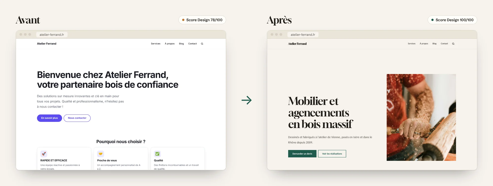
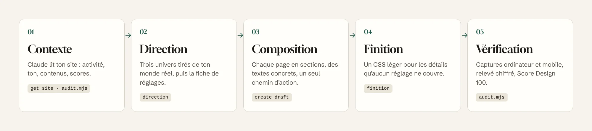
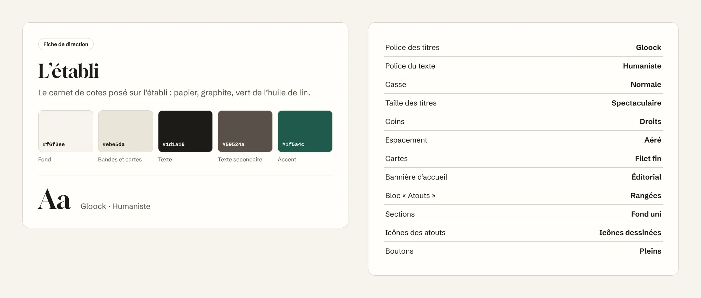

<p align="center">
  <b>Français</b> · <a href="README.en.md">English</a> · <a href="README.es.md">Español</a> · <a href="README.de.md">Deutsch</a> · <a href="README.pt-BR.md">Português</a> · <a href="README.it.md">Italiano</a>
</p>

<p align="center">
  <picture>
    <source media="(prefers-color-scheme: dark)" srcset="docs/images/banner-dark.webp">
    
  </picture>
</p>

<p align="center">
  
  
  
  
  <a href="LICENSE"></a>
</p>

<h3 align="center">Ton site Éclair a la vitesse d'un site statique.<br>Éclair Design lui donne l'allure d'un site de studio.</h3>

<p align="center">
  <a href="#installer-en-1-minute"><b>Installer</b></a> ·
  <a href="#pourquoi-éclair-design"><b>Pourquoi</b></a> ·
  <a href="#lapproche"><b>L'approche</b></a> ·
  <a href="#une-direction-artistique-pas-un-thème"><b>Direction artistique</b></a> ·
  <a href="#des-pages-qui-font-agir"><b>Pages</b></a> ·
  <a href="#utiliser"><b>Utiliser</b></a> ·
  <a href="#questions-fréquentes"><b>FAQ</b></a>
</p>

<br>

<p align="center">
  
</p>

<p align="center"><sub>Le même site Éclair, le même contenu de départ, une conversation avec Claude. Score Design calculé par Éclair : 78 → 100.</sub></p>

## Pourquoi Éclair Design

[Éclair CMS](https://github.com/Jacckisback/eclair-cms) règle la technique : Lighthouse 100, SEO et GEO intégrés, sécurité, zéro maintenance. Mais un site rapide n'est pas forcément un site qui inspire confiance. Sans œil de designer, beaucoup de sites finissent pareils : couleur par défaut, « Bienvenue chez… », trois cartes avec une fusée, « solutions sur mesure ».

**Éclair Design est un skill pour Claude** qui joue le rôle du directeur artistique que la plupart des indépendants et des petites entreprises n'ont pas. Il connaît Éclair de l'intérieur : chaque réglage, chaque bloc, chaque règle du Score Design. Il ne produit pas une maquette à recoder : il te donne exactement quoi régler, quoi écrire et quoi coller, et avec le connecteur MCP d'Éclair, il prépare lui-même les pages en brouillon.

<table>
  <tr>
    <td width="33%" valign="top">
      <h3>🎨 Un univers, pas un thème</h3>
      Une direction artistique tirée du monde réel de l'activité (l'établi, la serre, l'imprimerie de nuit), avec ses couleurs, sa police et ses compositions. Jamais les clichés de la catégorie, jamais les tics du design généré par IA.
    </td>
    <td width="33%" valign="top">
      <h3>✍️ Des pages qui font agir</h3>
      Bannière qui dit qui, quoi, où. Atouts qui prouvent au lieu d'affirmer. Un seul chemin d'action. Des textes sans formules creuses. <b>Score Design visé : 100.</b>
    </td>
    <td width="33%" valign="top">
      <h3>⚡ Rien ne casse</h3>
      Le skill passe uniquement par les réglages d'Éclair. Le HTML ne change pas : vitesse, accessibilité, SEO et données structurées restent intacts. Les mises à jour d'Éclair ne défont rien.
    </td>
  </tr>
</table>

### Ce que ça t'apporte

| Tu es… | Sans Éclair Design | Avec Éclair Design |
|---|---|---|
| **Artisan, indépendant, commerce** | Un site correct qui ressemble à celui des concurrents, ou un devis d'agence hors budget | Un site qui a l'air fait sur mesure, en une après-midi, avec tes mots et tes photos |
| **Freelance ou agence web** | Des heures à choisir couleurs, polices et mises en page pour chaque client | Une méthode reproductible : audit noté, 3 pistes à présenter au client, fiche de réglages, pages en brouillon |
| **Formateur ou revendeur Éclair** | « Le site est rapide, mais il fait un peu basique » | Un argument visuel immédiat : le même site, avant et après |

## L'approche

<p align="center">
  
</p>

Éclair Design réunit deux écoles et les plie aux contraintes d'Éclair :

- **[Impeccable](https://github.com/pbakaus/impeccable)** (Paul Bakaus) pour la direction : partir d'**une référence concrète** du monde du client, faire des choix francs, refuser le design par défaut. Éclair s'en inspire déjà pour ses directions artistiques et son Score Design ; le skill pousse la méthode jusqu'au bout.
- **[Emil Kowalski](https://github.com/emilkowalski/skill)** pour la finition : les détails invisibles qui s'additionnent (pression des boutons, courbes d'animation, survols réservés à la souris, chiffres alignés), et l'animation seulement quand elle a une raison.

Et une règle propre à Éclair : **travailler avec ses leviers, jamais contre eux.**

| Ordre | Levier | Où |
|---|---|---|
| 1 | Direction artistique : 5 couleurs, police de titre, compositions | Réglages › Apparence |
| 2 | Composition des pages en sections | Éditeur, ou connecteur MCP |
| 3 | Textes : titres, accroches, atouts, boutons, FAQ | Éditeur, ou connecteur MCP |
| 4 | Médias : photo de bannière, équipe, textes alternatifs | Médiathèque |
| 5 | CSS personnalisé, en dernier recours | Réglages › Apparence |

Le skill ne touche jamais aux fichiers d'Éclair (écrasés à chaque mise à jour), n'invente aucun fait (prix, chiffres, avis) et ne publie rien : tout arrive en brouillon ou en proposition à valider d'un clic.

## Une direction artistique, pas un thème

<p align="center">
  
</p>

Éclair propose 12 directions artistiques et un réglage fin de chacune. Le skill t'aide à **choisir la bonne, ou à créer la tienne** :

1. il lit ton activité et imagine le monde physique autour (lieux, matières, outils, lumière) ;
2. il propose **3 pistes vraiment différentes**, chacune tirée d'une référence concrète ;
3. il évite le cliché de ta catégorie (marine et or pour les avocats, violet pour la tech, beige et sauge pour le bien-être) et les tics du design par IA ;
4. il vise directement des couleurs qui passent les contrastes WCAG garantis par Éclair, pour que le rendu soit celui annoncé ;
5. il te remet **la fiche de réglages**, dans l'ordre exact de l'écran :

<p align="center">
  
</p>

Tu la recopies dans **Réglages › Apparence › Ajuster la direction**, tu regardes l'aperçu en direct sur ordinateur et sur mobile, tu enregistres. Envie d'ajuster ? « Plus sobre », « plus audacieux », « plus haut de gamme » : le skill transforme la direction et te redonne la fiche complète.

## Des pages qui font agir

<p align="center">
  
</p>

Une belle palette ne suffit pas : c'est la composition et les mots qui convainquent. Pour chaque type de page (accueil, service, à propos, contact, landing, boutique, article), le skill applique des recettes précises :

- **Bannière** : 8 mots au plus, qui disent ce que le visiteur obtient ; une accroche qui apporte une preuve ; un bouton verbe + objet (« Demander un devis », jamais « En savoir plus »).
- **Atouts** : 3 à 6, chacun un fait vérifiable (« Chêne du Jura séché 18 mois ») plutôt qu'un adjectif (« Qualité »).
- **Rythme** : une section, un rôle ; jamais plus de trois paragraphes d'affilée ; un seul chemin d'action.
- **Textes** : aucune formule creuse (« innovant », « clé en main », « n'hésitez pas »), aucune majuscule criarde, aucun fait inventé. Ce qui manque devient `[À compléter : …]`.

Avec le connecteur MCP d'Éclair branché, Claude crée la page **en brouillon** et te renvoie ses scores. Sur la démo ci-dessus : **Score Design 78 → 100**, et le score SEO passe de 36 à 69 sans toucher aux réglages SEO, simplement parce que les textes disent enfin quelque chose.

### Sur mobile aussi

<p align="center">
  
</p>

Chaque livrable est vérifié à 390 px de large. Le script d'audit fournit les captures ordinateur et mobile, et signale les débordements, les petites cibles tactiles et les titres coupés.

## Installer en 1 minute

**Avec la CLI `skills`** (Claude Code, Cursor, Codex et les autres agents compatibles) :

```bash
npx skills add Jacckisback/eclair-design
```

**À la main** : copie le dossier [`skills/eclair-design/`](skills/eclair-design/) dans `~/.claude/skills/` (tous tes projets) ou dans `.claude/skills/` d'un projet.

**Sur Claude.ai** : zippe le dossier `eclair-design` et importe-le dans la section Skills des réglages.

**Pour que Claude agisse directement sur ton site** (recommandé) : dans Éclair, ouvre **Réglages › Assistant IA**, active **Autoriser les connexions MCP**, puis ajoute l'adresse `https://ton-site.fr/_eclair/mcp` comme connecteur personnalisé dans Claude. Sans connecteur, le skill travaille à partir de l'URL du site et te donne les textes et les réglages à recopier.

**Pour l'audit automatique** : Node 18+ et Playwright (`npm i -D playwright && npx playwright install chromium`).

## Utiliser

| Commande | Ce que tu obtiens |
|---|---|
| `/eclair-design audit https://ton-site.fr` | Note sur 32 en 8 critères, captures ordinateur et mobile, plan d'action P0 → P3 |
| `/eclair-design direction` | 3 pistes tirées de ton activité, puis la fiche de réglages de celle que tu choisis |
| `/eclair-design page accueil` | La page composée section par section, textes compris, créée en brouillon |
| `/eclair-design finition` | Un bloc de CSS personnalisé commenté, sûr pour Lighthouse 100 |
| `/eclair-design plus-sobre` · `plus-audacieux` · `épurer` | La direction transformée, avec la fiche complète |

Ou parle normalement :

> « Rends mon site Éclair plus pro. Je suis ébéniste à Vienne, je fais surtout des cuisines et des bibliothèques sur mesure. »

> « Refais la page d'accueil de mon site de plombier : je veux plus d'appels, moins de blabla. »

> « Fais l'audit design de https://mon-site.fr et dis-moi par quoi commencer. »

### Exemple de finition

Le CSS n'arrive qu'en dernier, quand la direction et les pages sont en place. Il n'utilise que les variables du thème, donc il suit la direction et le mode sombre :

```css
/* Boutons : propriétés nommées, courbe franche */
:root{--ease-out:cubic-bezier(.23,1,.32,1)}
.btn{transition:transform .16s var(--ease-out),box-shadow .2s var(--ease-out),background-color .2s ease}
@media (prefers-reduced-motion:no-preference){.btn:active{transform:scale(.97)}}

/* Survols : seulement à la souris (sur mobile ils restent collés) */
@media not all and (hover:hover) and (pointer:fine){.btn:hover,.card:hover{transform:none;box-shadow:none}}

/* Titres : pas de mot coupé par un tiret sur mobile */
h1,h2,.hero-title{hyphens:manual}
```

## Ce que contient le skill

```
skills/eclair-design/
├── SKILL.md                  méthode, leviers, commandes, garde-fous
├── reference/
│   ├── leviers.md            valeurs permises d'Éclair, sections, MCP, Score Design, icônes, CSS
│   ├── direction.md          créer et transformer une direction, fiche de réglages
│   ├── composition.md        recettes de pages et règles d'écriture
│   ├── finition-css.md       CSS personnalisé de finition
│   └── audit.md              grille de notation sur 32 et modèle de rapport
├── scripts/audit.mjs         captures ordinateur + mobile et relevé chiffré
└── NOTICE.md                 crédits
```

Toutes les valeurs (couleurs, 18 polices, compositions, règles du Score Design, 65 icônes) sont relevées dans le code d'Éclair 1.14.1, pas inventées.

## Questions fréquentes

**Faut-il savoir coder ?**
Non. Le skill te donne des réglages à recopier et des textes à coller. Le CSS est facultatif, et livré prêt à coller.

**Mon site va-t-il ralentir ?**
Non. La direction artistique est un réglage natif d'Éclair (une seule police de titre, servie par ton site). Le CSS de finition pèse environ 1 Ko. Le HTML ne change pas.

**Claude peut-il casser ou publier quelque chose ?**
Non. Le connecteur MCP d'Éclair ne crée que des brouillons et des propositions ; il ne publie, ne supprime et ne règle rien. C'est toi qui cliques.

**Combien ça coûte ?**
Le skill est gratuit et open source. Il fonctionne avec ton abonnement Claude ; le connecteur MCP d'Éclair ne consomme aucune clé d'API du site.

**Et sans le connecteur MCP ?**
Le skill lit ton site à partir de son URL et te donne tout à recopier. Le connecteur fait seulement gagner du temps.

**Ça marche avec WordPress ou un autre CMS ?**
Non, et c'est voulu : le skill est précis parce qu'il connaît chaque réglage d'Éclair. Pour un autre CMS, la méthode reste valable mais les fiches ne s'appliquent pas.

## Crédits et licence

- Méthodes adaptées d'[Impeccable](https://github.com/pbakaus/impeccable) (Paul Bakaus, Apache 2.0) et des [skills d'Emil Kowalski](https://github.com/emilkowalski/skill) (MIT). Détails dans [NOTICE.md](skills/eclair-design/NOTICE.md).
- Démonstration : « Atelier Ferrand » est une entreprise fictive. Photos [Unsplash](https://unsplash.com/license). Captures réalisées avec Éclair 1.14.1 ; les scores sont ceux calculés par Éclair.
- Polices Fontsource (SIL Open Font License), icônes d'Éclair dérivées de Lucide (ISC).

© 2026 Thierry Gustin · [Éclair CMS](https://github.com/Jacckisback/eclair-cms) · Licence [AGPL-3.0](LICENSE).
