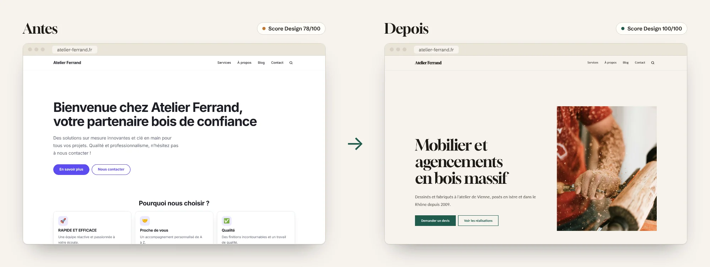
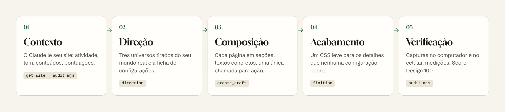
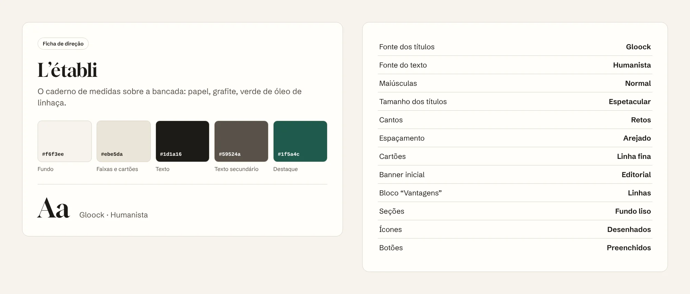

<p align="center">
  <a href="README.md">Français</a> · <a href="README.en.md">English</a> · <a href="README.es.md">Español</a> · <a href="README.de.md">Deutsch</a> · <b>Português</b> · <a href="README.it.md">Italiano</a>
</p>

<p align="center">
  <picture>
    <source media="(prefers-color-scheme: dark)" srcset="docs/images/banner-dark.webp">
    
  </picture>
</p>

<p align="center">
  
  
  
  
  <a href="LICENSE"></a>
</p>

<h3 align="center">Seu site Éclair já tem a velocidade de um site estático.<br>O Éclair Design dá a ele a cara de um site feito por um estúdio.</h3>

<p align="center">
  <a href="#instalar-em-1-minuto"><b>Instalar</b></a> ·
  <a href="#por-que-o-éclair-design"><b>Por quê</b></a> ·
  <a href="#a-abordagem"><b>Abordagem</b></a> ·
  <a href="#uma-direção-de-arte-não-um-tema"><b>Direção de arte</b></a> ·
  <a href="#páginas-que-levam-à-ação"><b>Páginas</b></a> ·
  <a href="#como-usar"><b>Como usar</b></a> ·
  <a href="#perguntas-frequentes"><b>FAQ</b></a>
</p>

<br>

<p align="center">
  
</p>

<p align="center"><sub>O mesmo site Éclair, o mesmo conteúdo de partida, uma conversa com o Claude. Score Design calculado pelo Éclair: 78 → 100.</sub></p>

## Por que o Éclair Design

O [Éclair CMS](https://github.com/Jacckisback/eclair-cms) resolve a parte técnica: Lighthouse 100, SEO e GEO integrados, segurança, zero manutenção. Mas um site rápido não é necessariamente um site que inspira confiança. Sem olhar de designer, muitos sites acabam iguais: cor padrão, "Bem-vindo à…", três cartões com um foguete, "soluções sob medida".

**O Éclair Design é um skill para o Claude** que faz o papel do diretor de arte que a maioria dos autônomos e pequenas empresas não tem. Ele conhece o Éclair por dentro: cada configuração, cada bloco, cada regra do Score Design. Ele não entrega um layout para ser programado: diz exatamente o que configurar, o que escrever e o que colar, e com o conector MCP do Éclair ele mesmo prepara as páginas em rascunho.

<table>
  <tr>
    <td width="33%" valign="top">
      <h3>🎨 Um universo, não um tema</h3>
      Uma direção de arte tirada do mundo real do negócio (a bancada, a estufa, a gráfica à noite), com suas cores, sua fonte e suas composições. Nunca os clichês do setor, nunca os vícios do design gerado por IA.
    </td>
    <td width="33%" valign="top">
      <h3>✍️ Páginas que levam à ação</h3>
      Um banner que diz quem, o quê e onde. Vantagens que provam em vez de afirmar. Um único caminho de ação. Textos sem frases vazias. <b>Meta: Score Design 100.</b>
    </td>
    <td width="33%" valign="top">
      <h3>⚡ Nada quebra</h3>
      O skill só usa as configurações do Éclair. O HTML não muda: velocidade, acessibilidade, SEO e dados estruturados ficam intactos. As atualizações do Éclair não desfazem nada.
    </td>
  </tr>
</table>

### O que ele traz para você

| Você é… | Sem o Éclair Design | Com o Éclair Design |
|---|---|---|
| **Artesão, autônomo, comércio local** | Um site correto, parecido com o dos concorrentes, ou um orçamento de agência fora do seu alcance | Um site com cara de feito sob medida, em uma tarde, com suas palavras e suas fotos |
| **Freelancer ou agência web** | Horas escolhendo cores, fontes e layouts para cada cliente | Um método repetível: auditoria com nota, 3 propostas para o cliente, ficha de configurações, páginas em rascunho |
| **Instrutor ou revendedor do Éclair** | "O site é rápido, mas parece meio básico" | Um argumento visual imediato: o mesmo site, antes e depois |

## A abordagem

<p align="center">
  
</p>

O Éclair Design une duas escolas e as adapta às regras do Éclair:

- **[Impeccable](https://github.com/pbakaus/impeccable)** (Paul Bakaus) para a direção: partir de **uma referência concreta** do mundo do cliente, fazer escolhas firmes, recusar o design padrão. O Éclair já se inspira nele para suas direções de arte e seu Score Design; o skill leva o método até o fim.
- **[Emil Kowalski](https://github.com/emilkowalski/skill)** para o acabamento: os detalhes invisíveis que se somam (o toque dos botões, as curvas de animação, o hover só com mouse, os números alinhados), e animação só quando tem um motivo.

E uma regra própria do Éclair: **trabalhar com as alavancas dele, nunca contra elas.**

| Ordem | Alavanca | Onde |
|---|---|---|
| 1 | Direção de arte: 5 cores, fonte dos títulos, composições | Configurações › Aparência |
| 2 | Composição das páginas em seções | Editor, ou conector MCP |
| 3 | Textos: títulos, chamadas, vantagens, botões, FAQ | Editor, ou conector MCP |
| 4 | Mídia: foto do banner, equipe, textos alternativos | Biblioteca de mídia |
| 5 | CSS personalizado, como último recurso | Configurações › Aparência |

O skill nunca mexe nos arquivos do Éclair (substituídos a cada atualização), não inventa nenhum dado (preços, números, avaliações) e não publica nada: tudo chega como rascunho ou como proposta que você aprova com um clique.

## Uma direção de arte, não um tema

<p align="center">
  
</p>

O Éclair traz 12 direções de arte, todas ajustáveis. O skill ajuda você a **escolher a certa ou criar a sua**:

1. ele lê o seu negócio e imagina o mundo físico ao redor (lugares, materiais, ferramentas, luz);
2. propõe **3 caminhos realmente diferentes**, cada um tirado de uma referência concreta;
3. evita o clichê do seu setor (azul-marinho e dourado para advogados, roxo para tecnologia, bege e verde-sálvia para bem-estar) e os vícios do design por IA;
4. escolhe direto cores que passam nos contrastes WCAG garantidos pelo Éclair, para que o resultado seja o anunciado;
5. entrega **a ficha de configurações**, na ordem exata da tela:

<p align="center">
  
</p>

Você copia em **Configurações › Aparência › Ajustar a direção**, confere a pré-visualização ao vivo no computador e no celular e salva. Quer ajustar? "Mais sóbrio", "mais ousado", "mais sofisticado": o skill transforma a direção e devolve a ficha completa.

## Páginas que levam à ação

<p align="center">
  
</p>

Uma paleta bonita não basta: o que convence é a composição e as palavras. Para cada tipo de página (inicial, serviço, sobre, contato, landing, loja, artigo), o skill aplica receitas precisas:

- **Banner**: no máximo 8 palavras, dizendo o que o visitante recebe; uma chamada que traz uma prova; um botão verbo + objeto ("Pedir orçamento", nunca "Saiba mais").
- **Vantagens**: de 3 a 6, cada uma um fato verificável ("Carvalho do Jura seco por 18 meses") em vez de um adjetivo ("Qualidade").
- **Ritmo**: uma seção, uma função; nunca mais de três parágrafos seguidos; um único caminho de ação.
- **Textos**: nada de frases vazias ("inovador", "de ponta", "chave na mão"), nada de maiúsculas gritantes, nenhum dado inventado. O que falta vira `[A completar: …]`.

Com o conector MCP do Éclair, o Claude cria a página **em rascunho** e devolve suas pontuações. Na demonstração acima: **Score Design 78 → 100**, e a nota de SEO passa de 36 para 69 sem mexer em nenhuma configuração de SEO, simplesmente porque os textos finalmente dizem alguma coisa.

### No celular também

<p align="center">
  
</p>

Cada entrega é verificada com 390 px de largura. O script de auditoria gera capturas no computador e no celular e aponta estouros de layout, áreas de toque pequenas e títulos quebrados.

## Instalar em 1 minuto

**Com a CLI `skills`** (Claude Code, Cursor, Codex e outros agentes compatíveis):

```bash
npx skills add Jacckisback/eclair-design
```

**Manualmente**: copie a pasta [`skills/eclair-design/`](skills/eclair-design/) para `~/.claude/skills/` (todos os seus projetos) ou para `.claude/skills/` de um projeto.

**No Claude.ai**: compacte a pasta `eclair-design` em zip e importe na seção Skills das configurações.

**Para o Claude trabalhar direto no seu site** (recomendado): no Éclair, abra **Configurações › Assistente de IA**, ative **Permitir conexões MCP** e adicione o endereço `https://seu-site.com.br/_eclair/mcp` como conector personalizado no Claude. Sem conector, o skill trabalha a partir da URL do site e entrega os textos e as configurações para copiar.

**Para a auditoria automática**: Node 18+ e Playwright (`npm i -D playwright && npx playwright install chromium`).

## Como usar

| Comando | O que você recebe |
|---|---|
| `/eclair-design audit https://seu-site.com.br` | Nota sobre 32 em 8 critérios, capturas no computador e no celular, plano de ação P0 → P3 |
| `/eclair-design direction` | 3 propostas tiradas do seu negócio e a ficha de configurações da escolhida |
| `/eclair-design page accueil` | A página inicial composta seção por seção, com textos, criada em rascunho |
| `/eclair-design finition` | Um bloco de CSS personalizado comentado, seguro para o Lighthouse 100 |
| `/eclair-design plus-sobre` · `plus-audacieux` · `épurer` | A direção mais sóbria, mais ousada ou mais limpa, com a ficha completa |

Ou simplesmente converse:

> "Deixe meu site Éclair mais profissional. Sou marceneiro em Curitiba e faço principalmente cozinhas e estantes sob medida."

> "Refaça a página inicial do meu site de encanador: quero mais ligações e menos enrolação."

> "Faça a auditoria de design de https://meu-site.com.br e me diga por onde começar."

O skill responde no seu idioma; os comandos mantêm o nome em francês, porque o Éclair nasceu na França.

### Exemplo de acabamento

O CSS vem por último, quando a direção e as páginas estão prontas. Ele só usa as variáveis do tema, então acompanha a direção e o modo escuro:

```css
/* Botões: propriedades nomeadas, curva firme */
:root{--ease-out:cubic-bezier(.23,1,.32,1)}
.btn{transition:transform .16s var(--ease-out),box-shadow .2s var(--ease-out),background-color .2s ease}
@media (prefers-reduced-motion:no-preference){.btn:active{transform:scale(.97)}}

/* Hover: só com mouse (no celular ele fica preso) */
@media not all and (hover:hover) and (pointer:fine){.btn:hover,.card:hover{transform:none;box-shadow:none}}

/* Títulos: nenhuma palavra cortada por hífen no celular */
h1,h2,.hero-title{hyphens:manual}
```

## O que o skill contém

```
skills/eclair-design/
├── SKILL.md                  método, alavancas, comandos, proteções
├── reference/
│   ├── leviers.md            valores permitidos do Éclair, seções, MCP, Score Design, ícones, CSS
│   ├── direction.md          criar e transformar uma direção, ficha de configurações
│   ├── composition.md        receitas de páginas e regras de escrita
│   ├── finition-css.md       CSS personalizado de acabamento
│   └── audit.md              grade de pontuação sobre 32 e modelo de relatório
├── scripts/audit.mjs         capturas no computador + celular e medições
└── NOTICE.md                 créditos
```

Todos os valores (cores, 18 fontes, composições, regras do Score Design, 65 ícones) foram tirados do código do Éclair 1.14.1, não inventados. As instruções internas do skill estão em francês.

## Perguntas frequentes

**Preciso saber programar?**
Não. O skill entrega configurações para copiar e textos para colar. O CSS é opcional e vem pronto para colar.

**Meu site vai ficar mais lento?**
Não. A direção de arte é uma configuração nativa do Éclair (uma única fonte de títulos, servida pelo seu próprio site). O CSS de acabamento pesa cerca de 1 KB. O HTML não muda.

**O Claude pode quebrar ou publicar alguma coisa?**
Não. O conector MCP do Éclair só cria rascunhos e propostas; não publica, não apaga e não muda configurações. Quem clica é você.

**Quanto custa?**
O skill é gratuito e de código aberto. Funciona com a sua assinatura do Claude; o conector MCP do Éclair não usa nenhuma chave de API do seu site.

**E sem o conector MCP?**
O skill lê seu site a partir da URL e entrega tudo para copiar. O conector só economiza tempo.

**Funciona com WordPress ou outro CMS?**
Não, e é de propósito: o skill é preciso porque conhece cada configuração do Éclair. O método vale em outros lugares, mas as fichas não.

## Créditos e licença

- Métodos adaptados do [Impeccable](https://github.com/pbakaus/impeccable) (Paul Bakaus, Apache 2.0) e dos [skills de Emil Kowalski](https://github.com/emilkowalski/skill) (MIT). Detalhes em [NOTICE.md](skills/eclair-design/NOTICE.md).
- Demonstração: "Atelier Ferrand" é uma empresa fictícia. Fotos do [Unsplash](https://unsplash.com/license). Capturas feitas com o Éclair 1.14.1; as pontuações são as calculadas pelo Éclair.
- Fontes da Fontsource (SIL Open Font License), ícones do Éclair derivados do Lucide (ISC).

© 2026 Thierry Gustin · [Éclair CMS](https://github.com/Jacckisback/eclair-cms) · Licença [AGPL-3.0](LICENSE).
